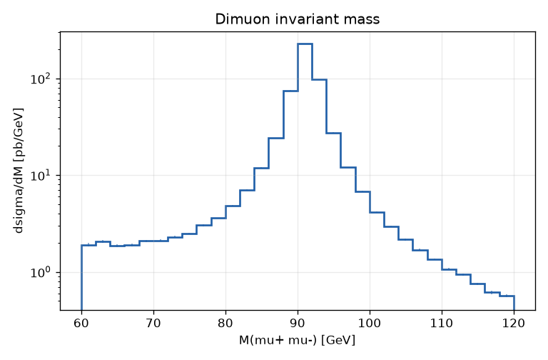
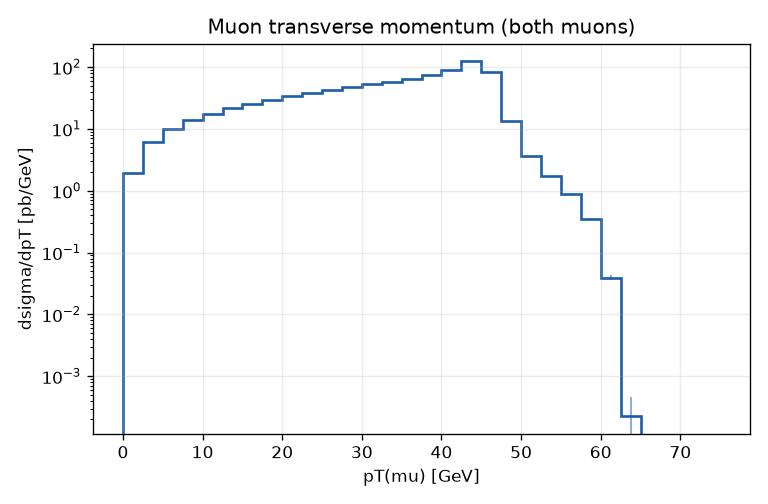
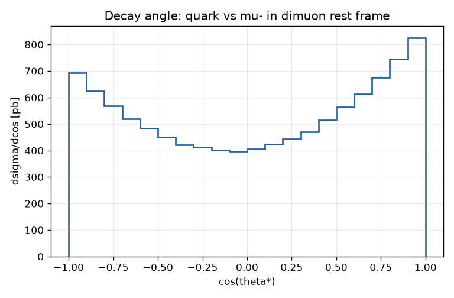
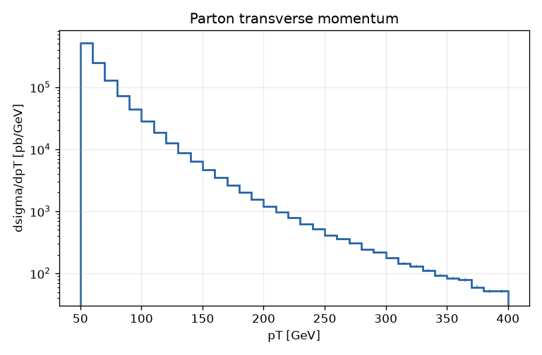
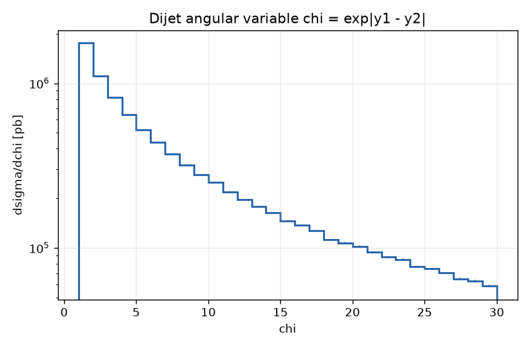

# ppmc: a Monte Carlo simulation of proton-proton collisions

A small, readable C++17 program that simulates what happens when two protons collide at
the Large Hadron Collider (LHC). It predicts **how often** a given kind of collision
happens (the *cross section*) and **what the debris looks like** (energies and directions
of the outgoing particles), using the same basic method as the professional
simulators physicists use (Pythia, Herwig, Sherpa, MadGraph), cut down to about
950 lines you can read in an afternoon.

<p align="center">
  
  
</p>

*Left: the Z boson shows up as a sharp peak at 91 GeV in the mass of muon pairs.
Right: each muon usually carries about half the Z mass (≈ 45 GeV) of momentum
sideways. Both come straight out of this simulator.*

---

## Contents

1. [Quick start](#1-quick-start)
2. [The physics in plain language](#2-the-physics-in-plain-language)
3. [What "Monte Carlo" means here](#3-what-monte-carlo-means-here)
4. [How the simulation works, step by step](#4-how-the-simulation-works-step-by-step)
5. [Reading the output](#5-reading-the-output)
6. [Command-line options](#6-command-line-options)
7. [Tour of the code](#7-tour-of-the-code)
8. [How we know it works](#8-how-we-know-it-works)
9. [What is simplified or left out](#9-what-is-simplified-or-left-out)
10. [Glossary](#10-glossary)
11. [Further reading](#11-further-reading)

---

## 1. Quick start

**You need:** a C++17 compiler (GCC 8+, Clang 7+, or MSVC 2019+). CMake is optional.
Python with `matplotlib` is optional (only used for PNG plots).

### Build with CMake

```bash
git clone https://github.com/<your-username>/pp-collision-monte-carlo.git
cd pp-collision-monte-carlo
cmake -S . -B build
cmake --build build
```

### …or build with a single compiler command

```bash
g++ -std=c++17 -O2 -Iinclude src/*.cpp -o ppmc
```

### Run it

```bash
./build/ppmc                          # Z bosons decaying to muons (default)
./build/ppmc --process dijet          # quark and gluon scattering ("jets")
./build/ppmc --help                   # all options
```

(On Windows the program is `build\ppmc.exe`; with Visual Studio it may be in `build\Release\`.)

### Run the self-tests

```bash
cd build && ctest --output-on-failure      # or run ./build/test_physics directly
```

### Make PNG plots (optional)

```bash
pip install matplotlib
python scripts/plot.py output             # writes output/*.png next to the CSV files
```

A run of 200,000 events takes well under a second.

---

## 2. The physics in plain language

### Protons are bags of smaller particles

A proton is not a solid ball. It is made of **quarks** (mostly two "up" quarks and one
"down" quark) held together by **gluons**, the carriers of the strong force. On top of
those, there is a constantly fluctuating "sea" of short-lived quark–antiquark pairs.
Physicists call all of these constituents **partons**.

When two protons collide at the LHC (each with 6,500 GeV of energy, about 7,000 times
its own mass), what actually collides is **one parton from each proton**. Each parton
carries only a fraction `x` of its proton's momentum, and that fraction is different
every time. The probability of finding a given parton with a given `x` is described by
**parton distribution functions (PDFs)**.

### What we simulate

The program offers two kinds of collision ("processes"):

| `--process` | What happens | Why it's interesting |
|---|---|---|
| `dy` (default) | A quark from one proton and an antiquark from the other annihilate into a **Z boson** or a virtual photon, which immediately decays into a **muon** and an **antimuon**: <br> `q q̄ → Z/γ* → μ⁻ μ⁺` | This is the **Drell–Yan process**. It's clean (muons are easy to detect), its rate is precisely predicted, and it's how the Z boson is measured at the LHC. |
| `dijet` | Two partons bounce off each other via the strong force: <br> `gg → gg`, `qg → qg`, `qq → qq`, `qq̄ → gg`, … | By far the most common hard collisions at the LHC. Each outgoing parton turns into a spray of particles called a **jet**. |

### What the simulator predicts

1. **The cross section σ.** How likely the process is, expressed as an
   effective "target area". It's measured in **barns** (1 barn = 10⁻²⁸ m²); at the
   LHC the handy units are picobarns (pb) and nanobarns (nb). Multiply σ by the
   amount of collision data (the *integrated luminosity*) and you get the number of
   times it happened. For example, 1,000 pb × 140 fb⁻¹ = 140 million Z bosons.
2. **Distributions.** Histograms of measurable quantities: the muons' momenta and
   angles, the mass of the muon pair, the jets' energies, and so on. These are exactly
   the kinds of plots experimental papers compare to.

---

## 3. What "Monte Carlo" means here

A Monte Carlo method answers a question by **averaging over random samples**.

The classic example: to estimate π, throw random darts at a square with a circle drawn
inside. The fraction landing in the circle approaches π/4. Nobody needs to solve an
integral; they just count.

Collision physics works the same way. The cross section is an integral over everything
that can vary in a collision:

$$
\sigma \;=\; \sum_{\text{partons } i,j} \int dx_1\, dx_2\; f_i(x_1)\, f_j(x_2)\;
\int d\Phi\; \frac{d\hat\sigma_{ij}}{d\Phi}
$$

In words: *(probability of finding parton i with momentum fraction x₁ in proton 1)
× (same for parton j in proton 2) × (probability those two partons produce what we
want, at those particular angles and energies)*, summed over every possibility.

This is a 4-to-6-dimensional integral with sharp peaks. Grids and formulas are
hopeless; random sampling is not. For each simulated "event" the program:

1. **Picks random values** for all the variables (`x₁`, `x₂`, angles, …).
2. **Computes a weight** `w` = (value of the integrand at that point) × (volume of
   the region it was sampled from), divided by how likely that point was to be picked.
3. **Records the event** (the four-momenta of all the particles) together with its weight.

Then:

* the **average weight** over N events → the **cross section** σ,
* the **statistical uncertainty** is (standard deviation of the weights) / √N, so
  4× more events gives 2× better precision,
* the **sum of weights falling into a histogram bin**, divided by N → the
  **cross section in that bin**. That's how the plots are made.

### Importance sampling: picking random numbers cleverly

If you sample uniformly, most points land where nothing happens and the result is
noisy. So the program samples **more often where the integrand is large** and gives
those points proportionally **smaller weights**. The answer is the same, but it
converges much faster. Two examples from the code:

* **Z peak:** the dimuon mass² is sampled from a Breit–Wigner shape,
  `M² = M_Z² + M_Z Γ_Z tan(ρ)` with `ρ` uniform, so most points sit right on the
  resonance ([`src/DrellYan.cpp`](src/DrellYan.cpp)).
* **Jets:** the cross section falls like 1/pT⁴, so `1/pT²` is sampled uniformly
  instead of `pT` ([`src/QCDDijet.cpp`](src/QCDDijet.cpp)).

The output line `Weight efficiency <w>/max` tells you how well this works: 1.0 would
mean every event has the same weight (perfect sampling).

---

## 4. How the simulation works, step by step

Everything uses **natural units**: energies, momenta and masses are in GeV, and
the speed of light c = 1. The beams travel along the z axis; proton 1 moves towards +z.

### Step 1 — Parton distribution functions ([`src/PDF.cpp`](src/PDF.cpp))

The toy proton contains up, down and strange quarks and antiquarks, plus gluons. Each
momentum distribution has the simple shape

$$
x f(x) = N\, x^{a}\,(1-x)^{b}
$$

* `(1-x)^b` makes it unlikely for one parton to carry almost all the proton's momentum;
* `x^a` controls behaviour at small `x`. Sea quarks and gluons (a < 0) become very
  numerous at small x.

The normalisations `N` are not free. They are fixed by facts about the proton:

| Rule | Meaning | Check (`ppmc --check-pdf`) |
|---|---|---|
| ∫ (u − ū) dx = 2 | the proton has 2 net up quarks | 2.0000 |
| ∫ (d − d̄) dx = 1 | …and 1 net down quark | 1.0000 |
| Σ ∫ x f(x) dx = 1 | all partons together carry 100 % of the momentum | 1.0000 |

The result: valence quarks carry ~31 % of the momentum, the sea ~21 %, gluons ~48 %,
close to what real PDF fits find at the energies relevant here.

### Step 2a — Drell–Yan: `q q̄ → γ*/Z → μ⁻ μ⁺` ([`src/DrellYan.cpp`](src/DrellYan.cpp))

**Random variables** (5 per event):

| Variable | Meaning | How it's sampled |
|---|---|---|
| `M²` | mass² of the muon pair = energy² of the colliding partons (ŝ) | Breit–Wigner around the Z |
| `y` | rapidity (how boosted along the beam) of the muon pair | uniform in the allowed range |
| `cos θ*` | angle of the μ⁻ in the pair's rest frame | uniform in [−1, 1] |
| `φ` | azimuthal angle around the beam | uniform in [0, 2π] |
| `kx, ky` | toy sideways kick to the Z (see §9) | Gaussian, width `--kt` |

The momentum fractions follow from `M` and `y`:  `x₁ = (M/√s) e^{+y}`,  `x₂ = (M/√s) e^{−y}`.

**The weight** combines the PDFs with the partonic cross section, summed over u, d, s
quarks, with the quark coming from either proton:

$$
\frac{d\hat\sigma}{d\cos\theta} \;=\; \frac{\pi\alpha^2}{8\,\hat s\, N_c}
\Big[\, \big(|A_{LL}|^2 + |A_{RR}|^2\big)(1+\cos\theta)^2
\;+\; \big(|A_{LR}|^2 + |A_{RL}|^2\big)(1-\cos\theta)^2 \,\Big]
$$

with one amplitude per combination of quark and muon *helicity* (left/right-handed):

$$
A_{ij} = Q_q Q_\mu \;+\; \frac{g_i^q\, g_j^\mu}{\sin^2\theta_W \cos^2\theta_W}\;
\frac{\hat s}{\hat s - M_Z^2 + i M_Z \Gamma_Z}
$$

The first term is photon exchange and the second is Z exchange. Because the program
adds them *before* squaring, it reproduces their **interference**, which makes the μ⁻
slightly prefer the direction of the incoming quark (the *forward–backward asymmetry*,
visible below). `N_c = 3` is the number of quark colours: a quark and antiquark only
annihilate if their colours match, which happens 1/3 of the time.

**Building the event:** the two muons are put back-to-back in the pair's rest frame,
each with energy M/2, at angles (θ*, φ). Then a Lorentz boost carries them to the lab
frame, where the pair moves along the beam with rapidity `y`.

<p align="center"></p>

*The (1 + cos²θ) shape comes from spin conservation. The tilt to the right is the
γ/Z interference, the same effect LEP and the LHC use to measure sin²θ_W.*

### Step 2b — Dijets: parton + parton → parton + parton ([`src/QCDDijet.cpp`](src/QCDDijet.cpp))

**Random variables:** the transverse momentum `pT` of the outgoing partons, their two
rapidities `y₃` and `y₄`, and an azimuthal angle `φ`. Momentum conservation then fixes
everything else:

$$
x_1 = \tfrac{p_T}{\sqrt s}\left(e^{y_3} + e^{y_4}\right), \qquad
x_2 = \tfrac{p_T}{\sqrt s}\left(e^{-y_3} + e^{-y_4}\right)
$$

If either `x` exceeds 1, the protons don't have enough energy and the weight is 0.

**The weight** is

$$
\frac{d\sigma}{dy_3\,dy_4\,dp_T^2} = \sum_{i,j} x_1 f_i(x_1)\; x_2 f_j(x_2)\;
\frac{\pi\,\alpha_s^2(p_T)}{\hat s^2}\;\overline{|\mathcal M_{ij}|^2}(\hat s,\hat t,\hat u)
$$

summed over **every** leading-order QCD subprocess (gg→gg, qg→qg, qq→qq, qq′→qq′,
qq̄→qq̄, qq̄→q′q̄′, qq̄→gg, gg→qq̄). The squared matrix elements are the standard textbook
formulas (Ellis–Stirling–Webber, Table 7.1). The strong coupling α_s **runs**: it gets
weaker at higher energy (asymptotic freedom), evaluated at the scale pT. One subprocess
is then chosen at random in proportion to its share, which decides the flavours of the
outgoing partons.

<p align="center">
</p>

*Left: the jet rate falls by four orders of magnitude between 50 and 400 GeV. Right:
χ = exp|y₁ − y₂| is the variable experiments use to look for new physics. Pure QCD
(Rutherford-like scattering of gluons) peaks at large χ, i.e. small scattering angles.*

### Step 3 — Analysis ([`src/main.cpp`](src/main.cpp))

Every event is passed to a small "analysis" that computes observables (the dimuon
mass, muon momenta, jet rapidities, …) and fills weighted histograms
([`src/Histogram.cpp`](src/Histogram.cpp)). For Drell–Yan it also applies the cuts of a
typical LHC detector (both muons with pT > 25 GeV and |η| < 2.5) to show how many
events would actually be *seen*.

---

## 5. Reading the output

A default run prints something like this (abridged):

```
 Process : Drell-Yan  pp -> gamma*/Z -> mu+ mu-
 sqrt(s) : 13000 GeV
 Events  : 200000   (seed 12345)
 Cuts    : 60 < M(mu mu) < 120 GeV

--- First few events (lab frame, GeV) ---
  Event 0:  u ubar -> gamma*/Z -> mu mu
    weight = 1.207e+03 pb,  x1 = 0.00259,  x2 = 0.01874,  Q = 90.61 GeV
    name  status             E        px        py         pz       pT       y
    ubar  in             16.85      0.00      0.00      16.85     0.00
    u     in            121.79      0.00      0.00    -121.79     0.00
    mu-   out            49.73    -39.27    -15.40     -26.34    42.18   -0.59
    mu+   out            88.91     38.64     15.33     -78.60    41.57   -1.39
    momentum balance (in - out): (-0.003, 0.628, 0.074, 0.003)
    (non-zero because of the toy kT kick; the rest of the proton, not simulated, recoils)

--- Results ---
 Total cross section     : 1.066 +- 0.0013 nb
 Seen by a detector      : 428.8 +- 0.54 pb   (both muons pT > 25 GeV, |eta| < 2.5)
 Detector acceptance     : 40.2 %
 Forward-backward asym.  : A_FB = 0.06732
 Expected events in 140 fb^-1 (LHC Run 2): 6.003e+07
```

How to read the event record:

* `in` rows are the two colliding partons. Here an anti-up quark carrying 0.26 % of
  proton 1's momentum hit an up quark carrying 1.9 % of proton 2's.
* `out` rows are the final particles. `E, px, py, pz` is the four-momentum in GeV;
  `pT` is the momentum sideways to the beam (what detectors measure best); `y` is the
  rapidity (0 = perpendicular to the beam, large = close to the beam pipe).
* Because x₂ > x₁, the system is boosted towards −z, so both muons have negative rapidity.

After the summary, text-mode histograms are drawn in the terminal and saved as CSV files
in `output/` (columns `x_low, x_high, value, error`, where `value` is a differential cross
section such as dσ/dM in pb/GeV). Use `scripts/plot.py` to turn them into PNGs.

---

## 6. Command-line options

| Option | Default | Meaning |
|---|---|---|
| `--process dy\|dijet` | `dy` | Which collision to simulate |
| `--events N` | 200000 | Number of events. Error shrinks like 1/√N |
| `--seed S` | 12345 | Random seed. Same seed → identical results |
| `--sqrts E` | 13000 | Proton–proton collision energy in GeV (LHC: 7000, 8000, 13000, 13600) |
| `--out DIR` | `output` | Where to write the CSV histograms |
| `--show N` | 3 | Print the first N events in full |
| `--quiet` | off | Don't draw text histograms |
| `--check-pdf` | off | Print the PDF sum rules and exit |
| `--mmin`, `--mmax` | 60, 120 | Drell–Yan: muon-pair mass window in GeV |
| `--kt K` | 2 | Drell–Yan: width of the toy sideways kick in GeV (0 = off) |
| `--ptmin P` | 50 | Dijets: minimum parton pT in GeV |
| `--ymax Y` | 4.5 | Dijets: maximum \|rapidity\| of each parton |

Things to try:

```bash
ppmc --sqrts 7000                      # how does the Z rate change at the 2011 LHC energy?
ppmc --mmin 20 --mmax 200              # see the photon take over at low mass
ppmc --process dijet --ptmin 500       # high-energy jets: qg -> qg overtakes gg -> gg
ppmc --process dijet --sqrts 1960      # the Tevatron (it collided p and anti-p, so only roughly)
```

---

## 7. Tour of the code

```
include/ppmc/
  Vec4.h        Four-vectors: invariant mass, pT, rapidity, Lorentz boosts
  Random.h      Seeded random-number generator (64-bit Mersenne Twister)
  Constants.h   Physical constants (Z mass, couplings, ...) and particle ID codes
  PDF.h         Toy parton distribution functions
  Event.h       The event record: list of particles + weight
  Process.h     Interface every physics process implements: generate(rng, event) -> weight
  DrellYan.h    q qbar -> gamma*/Z -> mu mu
  QCDDijet.h    All 2 -> 2 QCD scatterings
  Histogram.h   Weighted histograms with CSV and text output
src/
  PDF.cpp, DrellYan.cpp, QCDDijet.cpp, Histogram.cpp   implementations
  main.cpp      Command line, the event loop, the analysis, and the printout
tests/
  test_physics.cpp   Physics self-tests (see below)
scripts/
  plot.py       CSV -> PNG plots
```

The heart of the program is the event loop in `main.cpp`. Everything else exists to
make each line of it meaningful:

```cpp
for (long i = 0; i < opt.events; ++i) {
    const double w = process->generate(rng, ev);   // random collision + its weight
    stats.add(w);                                   // running average = cross section
    if (w > 0) analyse(ev);                         // fill histograms with weight w
}
```

**Adding a new process** means writing a class that derives from `Process`, picks
random kinematics, computes the weight in pb, and fills an `Event`. `DrellYan.cpp` is
the best template.

Particles are identified by the standard [PDG Monte Carlo numbering scheme](https://pdg.lbl.gov/2024/reviews/rpp2024-rev-monte-carlo-numbering.pdf):
1 = d, 2 = u, 3 = s, 21 = gluon, 13 = μ⁻, and a minus sign for antiparticles.

---

## 8. How we know it works

The self-tests (`ctest` or `./build/test_physics`) check the code against things
known independently of it:

| Test | What it checks |
|---|---|
| Lorentz boosts | Boosts preserve mass, are reversible, and shift rapidity additively |
| PDF sum rules | 2 up quarks, 1 down quark, 100 % of momentum |
| Z peak | At √ŝ = M_Z the partonic cross section matches the textbook Breit–Wigner formula σ = 12π Γ_qq Γ_μμ / (N_c M_Z² Γ_Z²) to 1 % |
| QED limit | Far below the Z it reduces to the pure-photon result 4πα²Q_q²/(3N_c ŝ) |
| Asymmetry | Above the Z peak the μ⁻ prefers the quark direction |
| Conservation | Four-momentum is conserved in every generated event |
| Running α_s | α_s(M_Z) = 0.118 and decreases with energy |
| Symmetry | gg→gg and qq→qq are symmetric under t̂ ↔ û (identical particles) |

**Comparison with real LHC measurements** (√s = 13 TeV):

| Quantity | This toy | Real world | Comment |
|---|---|---|---|
| σ(pp → Z → μμ), 60 < M < 120 GeV | 1.07 nb | 1.9 nb (measured, ATLAS/CMS) | The full theory includes higher-order QCD corrections (+30–40 %) and real PDFs. Getting within a factor 2 with toy PDFs and lowest-order physics is the expected level. |
| Fraction of momentum in gluons | 48 % | ≈ 45–50 % at Q ~ 100 GeV | Built into the toy PDFs |
| Low-pT jets dominated by | gg → gg (54 %), qg → qg (38 %) | gluon-initiated | Qualitatively right |

Use this program to **learn how event generators work**, not to make precision predictions.

---

## 9. What is simplified or left out

Real event generators do much more. In rough order of importance, this toy leaves out:

* **Real PDFs and their evolution.** Real parton distributions are fitted to data and
  change with the energy scale Q (DGLAP evolution). These toy PDFs have a fixed shape,
  tuned to look roughly like real ones at Q ~ 100 GeV. Libraries like
  [LHAPDF](https://lhapdf.hepforge.org/) provide the real thing.
* **Higher-order corrections.** Only the lowest order in the couplings is computed.
  Next-to-leading-order corrections change Drell–Yan rates by ~30 %.
* **Parton showers.** In reality the colliding and outgoing partons radiate many extra
  gluons. This is what gives the Z its sideways momentum. Here a Gaussian kick of width
  `--kt` is a stand-in: the event record then shows a small momentum imbalance, which
  physically would be absorbed by the unsimulated rest of the protons.
* **Hadronisation.** Quarks and gluons are never seen alone; they turn into jets of
  pions, kaons, protons, … The dijet events here stop at the parton level.
* **The underlying event.** The rest of each proton also produces soft particles,
  and at the LHC dozens of proton pairs collide at once ("pile-up").
* **Heavy quarks and other processes.** No charm or bottom in the proton, no W bosons,
  top quarks, Higgs bosons, …
* **Detector effects.** The "seen by a detector" number is just a geometric cut, with no
  efficiencies or resolution smearing.

Each of these is a good extension project.

---

## 10. Glossary

| Term | Meaning |
|---|---|
| **GeV** | Giga-electron-volt, the unit of energy, momentum and mass (c = 1). A proton's mass ≈ 0.938 GeV. |
| **√s** | Total collision energy of the two protons (13,000 GeV = 13 TeV at the LHC). |
| **ŝ** ("s-hat") | Energy² of the two colliding *partons*: ŝ = x₁ x₂ s. |
| **t̂, û** | The other two Mandelstam variables, measuring momentum transfer, i.e. how sharply the partons scatter. |
| **Parton** | A constituent of the proton: quark, antiquark or gluon. |
| **x** | Fraction of the proton's momentum carried by a parton. |
| **PDF** | Parton distribution function: f(x) is the density of partons with momentum fraction x. |
| **Cross section σ** | Effective target area for a process; proportional to its probability. 1 pb = 10⁻⁴⁰ m². |
| **Luminosity** | Measure of how much collision data was collected (e.g. 140 fb⁻¹). Events = σ × luminosity. |
| **pT** | Transverse momentum: momentum perpendicular to the beam. |
| **Rapidity y** | ½ ln((E+pz)/(E−pz)); how far a particle points along the beam. Differences in y are unchanged by boosts along the beam. |
| **Pseudorapidity η** | −ln tan(θ/2), the purely geometric version of y (equal to y for massless particles). |
| **Four-vector** | (E, px, py, pz). Its "length" √(E² − p²) is the particle's mass, the same in every frame. |
| **Lorentz boost** | Change of reference frame to one moving at constant velocity (special relativity). |
| **Matrix element \|M\|²** | The quantum-mechanical probability of a specific partonic reaction, from Feynman diagrams. |
| **α_s, α** | Strengths of the strong and electromagnetic forces. |
| **Breit–Wigner** | The resonance shape of an unstable particle like the Z; its width Γ is inversely proportional to its lifetime. |
| **Event weight** | How much one simulated event contributes to the cross section, in pb. |
| **Jet** | Collimated spray of hadrons from an energetic quark or gluon. |

---

## 11. Further reading

* R.K. Ellis, W.J. Stirling, B.R. Webber, *QCD and Collider Physics* (Cambridge, 1996). The Drell–Yan and 2→2 formulas used here.
* A. Buckley et al., "General-purpose event generators for LHC physics", *Physics Reports* 504 (2011) 145, [arXiv:1101.2599](https://arxiv.org/abs/1101.2599). How the real generators work.
* T. Sjöstrand, "Monte Carlo Event Generation for LHC", [CERN lecture notes](https://arxiv.org/abs/hep-ph/0611247).
* M.D. Schwartz, *Quantum Field Theory and the Standard Model* (Cambridge, 2014). Chapter on e⁺e⁻ → μ⁺μ⁻ and the Z.
* [Particle Data Group](https://pdg.lbl.gov/): reference values for every constant in `Constants.h`.

## License

MIT. See [LICENSE](LICENSE).
